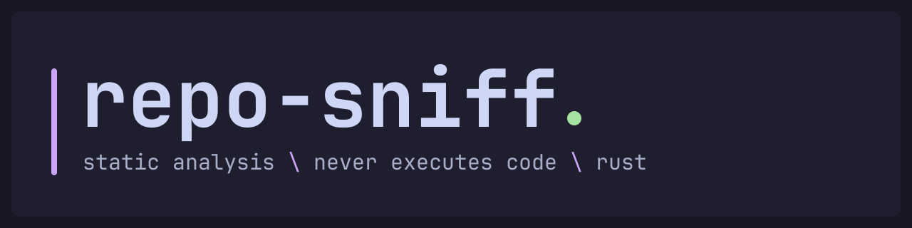

<picture>
  <source media="(prefers-color-scheme: dark)" srcset="https://raw.githubusercontent.com/z3nghoul/repo-sniff/main/docs/assets/banner-dark.svg">
  <source media="(prefers-color-scheme: light)" srcset="https://raw.githubusercontent.com/z3nghoul/repo-sniff/main/docs/assets/banner-light.svg">
  
</picture>

[](https://github.com/z3nghoul/repo-sniff/actions/workflows/ci.yml) [](LICENSE) [](https://www.rust-lang.org/) [](#guarantees)

sniff a repository before you run it


## why

Fake job test tasks, game "cheats", "tools" and exploit "PoCs" on GitHub are a
common way to get malware onto a developer's machine. They rarely need you to
run the program: `npm install`, `pip install`, opening the folder in VS Code
or building a Visual Studio project is enough to run code from the repository.
`repo-sniff` reads the repository before you take any of those steps and
reports, for every finding, the file and line, why it is suspicious and how
serious it is. It never runs anything from the repository.

## quick start

Install with a Rust toolchain and `git` (until 0.1.0 is on crates.io, from the
repository):

```sh
cargo install --locked --git https://github.com/z3nghoul/repo-sniff repo-sniff
```

Scan a remote repository or a local folder:

```sh
repo-sniff scan https://github.com/owner/repo
repo-sniff scan ./some-project
```

A project with a risky auto-run task:

```text
Scanned 1 files in .

CRITICAL  .vscode/tasks.json:6  ide.vscode-folder-open-task  [ide]
          task "setup" runs automatically when the folder is opened, and its command contains "curl"

Summary: 1 critical, 0 high, 0 medium, 0 low, 0 info
Scan time: 4 ms
Scan: complete (every file was read)
```

<details>
<summary>Options</summary>

| Option | Meaning |
|---|---|
| `--fail-on <SEVERITY>` | Exit with status 1 if any finding is at least this severe: `info`, `low`, `medium`, `high` (default) or `critical`. `none` never fails because of findings. |
| `--ref <REF>` | Branch or tag to scan. Only for remote repositories; the default branch is used otherwise. |

Scan a specific branch or tag of a remote repository:

```sh
repo-sniff scan https://github.com/owner/repo --ref v1.2.3
```

Build from source instead of installing:

```sh
git clone https://github.com/z3nghoul/repo-sniff
cd repo-sniff
cargo build --release
```

</details>

## what it catches

21 rules are built into the binary. Each line below is a summary; what exactly
each rule reads, how it grades and what it misses is in
[docs/DETECTIONS.md](docs/DETECTIONS.md), with MITRE ATT&CK techniques.

| Rule | Level | What it catches |
|---|---|---|
| `deception.bidi-control` | LOW to CRITICAL | Unicode bidi controls that make a line display differently from what runs (Trojan Source). |
| `deception.nul-byte-in-script` | HIGH | A NUL byte inside a script, which hides what follows it from editors and diffs. |
| `ide.vscode-folder-open-task` | MEDIUM to CRITICAL | A VS Code task that runs as soon as the folder is opened. |
| `deps.python-pth-exec` | INFO to CRITICAL | A Python `.pth` line that runs every time the interpreter starts. |
| `deps.python-start-entrypoint` | LOW, HIGH | A Python 3.15 `.start` entry point called at every interpreter start. |
| `deps.npm-lifecycle-hook` | INFO to CRITICAL | An npm script that runs on `npm install`, graded by what its command chain does. |
| `run.npm-script-local-server` | LOW to CRITICAL | An npm `start`, `dev`, `build` or `test` script that runs a local JavaScript file next to a front-end tool. |
| `run.js-fetch-eval` | MEDIUM to CRITICAL | JavaScript that passes data from a network call to `eval`, `new Function` or `vm`. |
| `run.js-function-require` | CRITICAL | `new Function("require", code)(require)`: assembled code gets the module loader. |
| `run.windows-remote-code` | MEDIUM to CRITICAL | A Windows command line that downloads and runs code (`IEX` with a download, `certutil`, `mshta`, ...). |
| `run.windows-defender-exclusion` | HIGH | A command that excludes paths from Windows Defender or switches a protection off. |
| `obfuscation.encoded-payload-sink` | HIGH | Decoded data (base64, hex, char codes) handed to a code or command sink in JavaScript. |
| `obfuscation.obfuscator-io` | LOW to CRITICAL | JavaScript in the shape of obfuscator.io output, CRITICAL when a tool runs the file. |
| `obfuscation.minified-source` | INFO to HIGH | A long minified line of code among ordinary sources. |
| `obfuscation.windows-encoded-payload` | MEDIUM to CRITICAL | `powershell -EncodedCommand`, `certutil -decode` and similar hidden commands. |
| `repo.disguised-executable` | CRITICAL | A native executable whose name promises something else (`logo.png`, `invoice.pdf.exe`). |
| `repo.committed-binary` | MEDIUM, HIGH | A committed native executable or library (HIGH) or loadable bytecode (MEDIUM). |
| `repo.windows-dropper` | HIGH, CRITICAL | A `.lnk`, `.scr` or `.hta` that Windows runs on a double click. |
| `repo.windows-script` | LOW to CRITICAL | A Windows script file, CRITICAL when its name poses as a document or image. |
| `repo.wsh-javascript` | MEDIUM | JavaScript that uses Windows Script Host objects. |
| `repo.symlink-outside` | MEDIUM, HIGH | A symbolic link that points outside the repository. |

## guarantees

- Code from the scanned repository is never executed: no install, no build, no
  scripts. The scanner only reads files.
- Your credentials are never used. Remote repositories are cloned over https
  only, anonymously, and a token pasted into a URL is hidden in every message.
- The clone is isolated: shallow, by a `git` with an empty environment,
  configuration and home directory: no filter, credential helper or fsmonitor
  from any configuration runs, hooks, templates and submodules are off,
  symlinks are written as plain files and nothing can prompt.
- Symlinks are listed, not followed (a symlinked VS Code tasks file is judged
  through the regular file it points at inside the repository), and text taken
  from the repository is cleaned before it is printed, so a repository cannot
  paint over the report.
- The work is bounded: 100,000 files, no file over 100 MiB, a file over 5 MiB
  read as a stream, no line over 16 MiB, 64 MiB read through symlinks per scan.
- An incomplete scan is never reported as clean: it ends with
  `Scan: INCONCLUSIVE`, says why, and exits with status 3.

These are design rules with tests, not a promise of absolute safety: the
scanner parses hostile input, so it can have bugs, and a clean result means
"no rule matched in what was read". The details are in
[docs/DETECTIONS.md](docs/DETECTIONS.md#7-how-the-scanner-protects-you).

## exit status

| Status | Meaning |
|---|---|
| 0 | Nothing reached the `--fail-on` threshold and the scan was complete. |
| 1 | A finding reached the threshold (this wins over 3). |
| 2 | The scan could not run: bad target, clone failure or wrong options. |
| 3 | Nothing reached the threshold, but the scan was inconclusive, even with `--fail-on none`. |

What makes a scan inconclusive and how binary files affect the status is in
[docs/DETECTIONS.md](docs/DETECTIONS.md#6-exit-status-and-binary-files).

## benchmark

Ten popular honest repositories, scanned from their default branches with
`repo-sniff scan <url>` on 2026-11-03. The scanner was `main` (`46b8501`), which
includes the loader signatures ([#107](https://github.com/z3nghoul/repo-sniff/pull/107)). The target
is 0 CRITICAL findings on honest code; it is met, and no scan is
INCONCLUSIVE.

| Repository | Exit | Critical | High | Medium | Low |
|---|---|---|---|---|---|
| BurntSushi/ripgrep | 0 | 0 | 0 | 0 | 0 |
| rust-lang/cargo | 0 | 0 | 0 | 0 | 0 |
| psf/requests | 0 | 0 | 0 | 0 | 1 |
| pallets/flask | 0 | 0 | 0 | 0 | 1 |
| pypa/pip | 1 | 0 | 6 | 0 | 0 |
| expressjs/express | 0 | 0 | 0 | 0 | 0 |
| microsoft/vscode | 1 | 0 | 9 | 13 | 52 |
| git/git | 0 | 0 | 0 | 3 | 5 |
| python/cpython | 1 | 0 | 2 | 1 | 28 |
| microsoft/terminal | 1 | 0 | 14 | 0 | 74 |

27 of the 31 HIGH findings are vendored executables (true detections of
benign files), one is a real folder-open task in vscode ([#43](https://github.com/z3nghoul/repo-sniff/issues/43)) and one is
vscode's extension host building a function from a fetched source. cpython's 2
are a known false positive ([#42](https://github.com/z3nghoul/repo-sniff/issues/42)), and they alone cause its exit 1. The
findings were the same in three runs on the same heads. Commits of the
scanned repositories, every HIGH and MEDIUM finding with a verdict, and how to
re-run it are in [docs/BENCHMARK.md](docs/BENCHMARK.md).

## limitations

- No AST yet: most rules read lines or simple structure, so code split across
  lines, built from string pieces or spread over several files can evade them
  until milestones 7 and 8. The known gaps of each rule are listed in
  [docs/DETECTIONS.md](docs/DETECTIONS.md).
- Link targets are judged as text, not resolved through other links in the
  repository; a chain or a directory link can hide a file or an exit from the
  repository ([#90](https://github.com/z3nghoul/repo-sniff/issues/90), with
  [#13](https://github.com/z3nghoul/repo-sniff/issues/13),
  [#69](https://github.com/z3nghoul/repo-sniff/issues/69) and
  [#85](https://github.com/z3nghoul/repo-sniff/issues/85)).
- Some npm script forms get a finding below their documented level: line
  continuations, carets in command names, wrappers such as `xargs` or
  `timeout` ([#105](https://github.com/z3nghoul/repo-sniff/issues/105)); hooks
  in `binding.gyp`, `.npmrc` and `.yarnrc.yml` are not read yet
  ([#103](https://github.com/z3nghoul/repo-sniff/issues/103)).
- The Windows loader signatures can be hidden by a here-string with `<#`, and a
  known installer URL lowers a whole line
  ([#108](https://github.com/z3nghoul/repo-sniff/issues/108)).
- A bidi control in JSON data can be lowered to MEDIUM in a few edge cases
  ([#111](https://github.com/z3nghoul/repo-sniff/issues/111)), and a line that
  starts with a right-to-left mark reorders with no control at all
  ([#94](https://github.com/z3nghoul/repo-sniff/issues/94)).
- FIFOs, devices and sockets are not listed in the report yet
  ([#36](https://github.com/z3nghoul/repo-sniff/issues/36)).
- A single line over 16 MiB makes an honest repository inconclusive
  ([#54](https://github.com/z3nghoul/repo-sniff/issues/54)).
- A payload renamed to `*.pth` while the package is built is not seen
  ([#11](https://github.com/z3nghoul/repo-sniff/issues/11)).
- There is no risk score, JSON, SARIF or GitHub Action yet.

Every open hardening item is in the
[issue tracker](https://github.com/z3nghoul/repo-sniff/issues?q=is%3Aissue%20is%3Aopen%20label%3Ahardening).

## self-scan and private repositories

`repo-sniff` never uses your git credentials: git runs with an empty home
directory and no credential helper, and it cannot ask for a password. Scanning
a private repository, or one that does not exist, fails with exit status 2 and
a message that says so. To scan a private repository, clone it yourself and
scan the folder:

```sh
git clone git@github.com:owner/private-repo.git some-folder
repo-sniff scan some-folder
```

The fixtures in this repository are stored defanged and become real only in a
temporary folder while the tests run, whereas the signatures in `src/` and
`rules/` are what the scanner looks for. `repo-sniff scan .` here therefore
reports far fewer findings than the fixtures hold: the ones left come from
invisible characters and constructions that cannot be defanged. The fixture paths are not excluded from a scan, because an
attacker can name a payload folder the same way, and a scanner that skipped
such paths would be blind to it.

## roadmap

- Milestone 2, in progress: the rest of automatic execution (IDE settings,
  .NET and MSBuild, Python install hooks, build scripts, GitHub Actions,
  human deception).
- Milestone 3: colored output, JSON, a risk score on three axes, `.repo-sniff.toml` exclusions.
- Milestone 4: SARIF, a GitHub Action and release binaries.
- Milestone 6: a terminal UI and localization.
- Milestones 7 to 9: capabilities and AST, obfuscation decoding, dependencies.

The full plan is in [ROADMAP.md](ROADMAP.md).

## development

```sh
cargo fmt --all
cargo clippy --workspace --all-targets -- -D warnings
cargo test --workspace
```

See [CONTRIBUTING.md](CONTRIBUTING.md) for the rules about commits, fixtures
and adding a detection, and [SECURITY.md](SECURITY.md) for reporting a
vulnerability in the scanner itself. Test fixtures are synthetic, harmless
files that only imitate suspicious patterns; each one is marked
`SYNTHETIC TEST FIXTURE — not functional`.

## license

[AGPL-3.0](LICENSE)

z3nghoul \ made in ukraine
